# Automated Purchase Order Overdue Reminder

**Acumatica ERP | Generic Inquiry | Business Events | Automation Schedule | Email Notifications**

## Table of Contents

- [1. Project Overview](#1-project-overview)
- [2. Business Background](#2-business-background)
- [3. Business Requirements](#3-business-requirements)
- [4. Proposed Solution](#4-proposed-solution)
- [5. Technical Implementation](#5-technical-implementation)
- [6. Email Notification Example](#6-email-notification-example)
- [7. Functional Testing](#7-functional-testing)
- [8. Key Contributions](#8-key-contributions)
- [9. Project Outcome](#9-project-outcome)

## 1. Project Overview

This project focuses on creating an automated email reminder for Purchase Orders (POs) created by stores that have not been received by their promised dates.

The solution uses Acumatica Generic Inquiry (GI), Business Events, Automation Schedules, and Mail Templates to check outstanding Purchase Orders and send daily email reminders to the relevant stores.

The goal is to help stores complete Goods Receipt (GR) on time so that the received goods can be processed into vendor bills and paid by the Finance team.

## 2. Business Background

The Procurement team needs stores to complete Goods Receipt (GR) on time, especially for Purchase Orders sent to vendors supplying daily operational needs.

GR is an important step in the purchasing process because the received goods must be recorded before they can be processed into vendor bills for Finance payment.

However, some stores do not complete GR by the promised date. This can delay the billing process and affect payment schedules.

To address this issue, an automated reminder was needed to notify stores about overdue Purchase Orders that had not yet been received.

## 3. Business Requirements

The system should:

- Identify Purchase Orders created by stores.
- Find Purchase Orders that have passed their promised dates but have not been received.
- Check outstanding Purchase Orders automatically every day.
- Send email reminders to the relevant stores.
- Use a predefined email template to keep notifications consistent.

## 4. Proposed Solution

I designed an automated reminder process using several Acumatica features:

| Acumatica Feature | Purpose |
|---|---|
| Generic Inquiry (GI) | Retrieves Purchase Orders that meet the overdue and outstanding criteria. |
| Business Events | Triggers email notifications based on the GI results. |
| Automation Schedule | Runs the checking process automatically at a scheduled time each day. |
| Mail Template | Defines the email subject and message content. |

The process runs automatically without requiring the Procurement team to manually check each Purchase Order and send reminders.

### Process Flowchart

  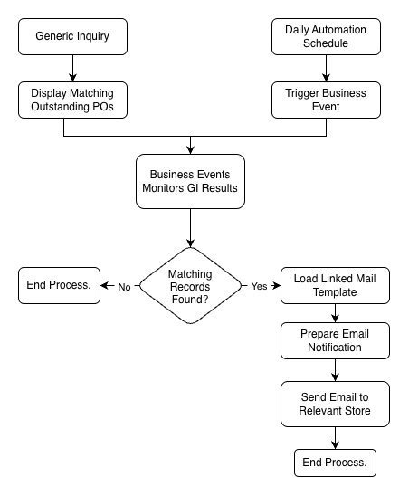  

## 5. Technical Implementation

### 5.1 Generic Inquiry Configuration

Created a Generic Inquiry to retrieve Purchase Orders created by stores that meet the required conditions.

The inquiry is used as the data source for the Business Event.

**GI Configuration:**

- Inquiry Name: Overdue Purchase Orders
- Purpose: Retrieve overdue Purchase Orders that have not been received.

1. Data Sources  
Shows the tables used as data sources for retrieving Purchase Order information.

  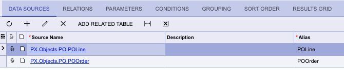  

 

2. Table Relationships 
Shows how the selected tables are connected to retrieve the required Purchase Order data.

  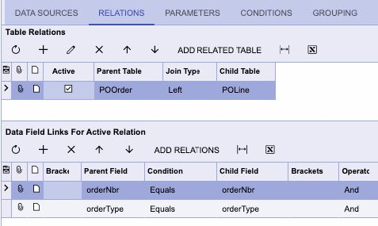

 

3. Conditions: 
   
| No. | Condition | Business Purpose |
|---|---|---|
|1| PO Expected Date >= Start of the Year | Includes only Purchase Orders with an Expected Date within the current year. POs from previous years are excluded from the reminder process.|
|2| PO Promised Date < Today | Identifies Purchase Orders with a Promised Date later than today, based on the configured business rule.|
|3| PO Created By = Stores | Limits the inquiry to Purchase Orders created by stores, as the reminder is specifically intended for store-created POs. |
|4| PO Vendor ID | Includes only selected vendors that supply daily operational needs, excluding other vendors from the reminder process. |
|5| PO Receipt Qty = 0 | Includes only PO that have not received any goods yet. |
 
Shows the conditions used to filter Purchase Orders based on the defined business requirements. 
 

  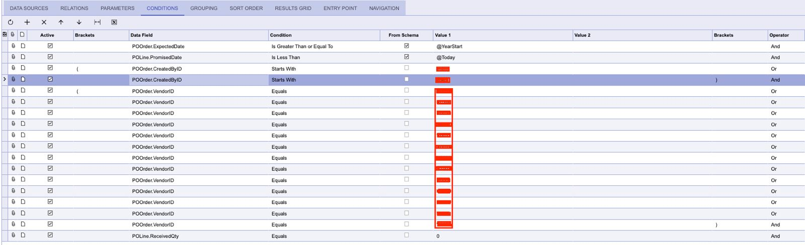  
 
 

4. Grouping  
Shows how the inquiry data is grouped to organize the Purchase Order records.

  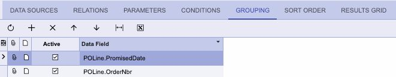  
 
 
 
5. Result Grid  
Shows the final inquiry results, displaying Purchase Orders that match the configured conditions.

  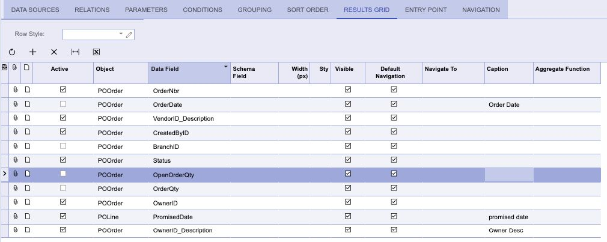  

 
 
### 5.2 Business Event Configuration

Created a Business Event using the Generic Inquiry as its data source.

The event is configured to trigger email notifications when matching Purchase Order records are identified during the scheduled process.

**Configuration:**

- Data Source: Overdue Purchase Orders
- Event Type: Trigger By Schedule
- Notification Method: Email

1. Subscribers  
   The Subscribers tab is used to link the Business Event with the Mail Template. This defines the email notification that will be sent when the event is triggered.
   

      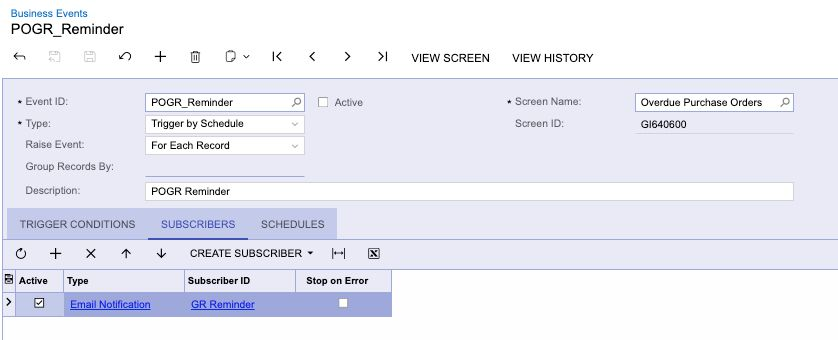  
    
 
2. Schedules  
   The Schedules tab is used to link the Business Event with the Automation Schedule, allowing the event to run automatically at a predefined time every day.
   

      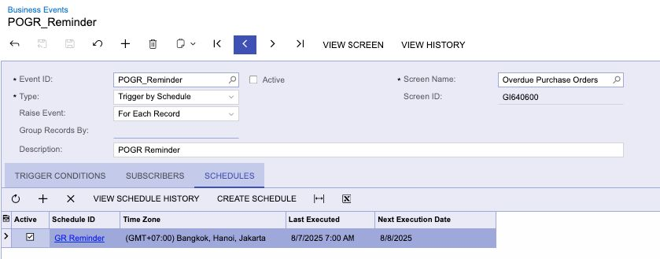  
    
 

### 5.3 Automation Schedule Configuration

Configured an Automation Schedule to run the Business Event automatically every day at a predefined time.

This allows Acumatica to check outstanding Purchase Orders regularly without manual intervention.

**Configuration:**

- Frequency: Daily
- Execution Time: Set Start & Stop Time 
1. Details
   Shows the main Automation Schedule settings, including its name and configuration details.
   

      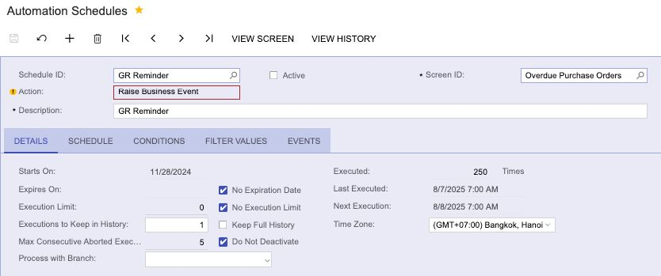  
    
 
    
2. Schedule
   Shows the schedule settings, including the frequency and time when the reminder process runs automatically.
    

      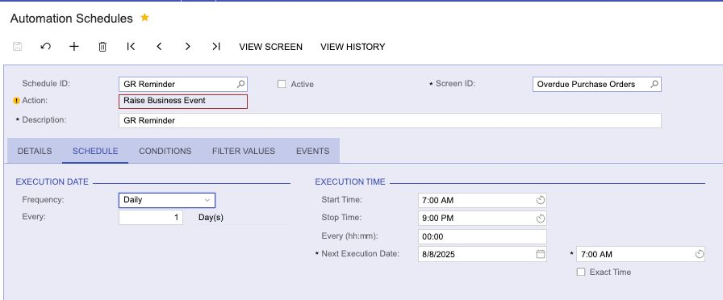  
    
 
    
3. Events
   Shows the Business Event linked to the Automation Schedule, allowing the reminder process to be triggered based on the configured schedule.
    

      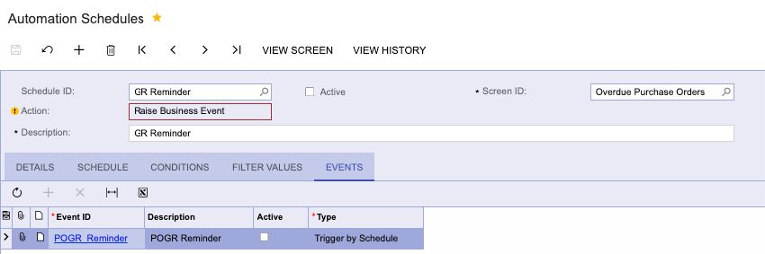  
    
 

### 5.4 Mail Template Configuration

Created an email template containing the reminder message and relevant Purchase Order information.

The template is linked to the Business Event so that the notification follows a consistent format.

**Configuration:**

- Template Name: GR Reminder
- Subject: Reminder: Please Complete Goods Receipt for PO ((POOrder_orderNbr))
- Recipients: ((POOrder_createdByID!Email));
- Email Content:
  

  Dear ((POOrder_ownerID_description)), 

  This is a friendly reminder to complete the Goods Receipt (GR) process in the system for the following Purchase Order. 
  Please find the details below: 
      Promised Date: ((POLine_promisedDate))  
      Purchase Order Number: ((POOrder_orderNbr)) 
  Please ensure that the Goods Receipt is completed correctly and on time to avoid delays in vendor invoice processing and payment. 

  Thank you for your attention and cooperation. 

  Best regards, 
  Procurement Team
  

## 6. Email Notification Example

The following screenshot shows an example of the automated email reminder sent to stores for overdue Purchase Orders. 
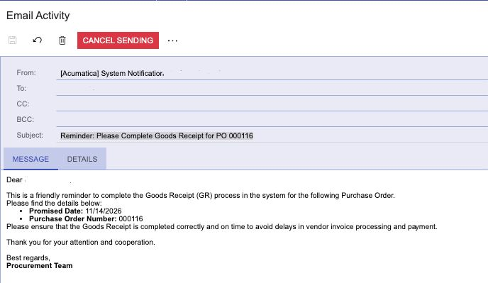

## 7. Functional Testing

The following test scenarios can be used to validate the reminder process.

| No | Test Scenario | Expected Result |
|---|---|---|
|1| PO with Expected Date within the current year, Promised Date has passed, created by a store, a declared VendorID, and Received Qty = 0. | PO appears in the GI and triggers an email reminder. |
|2| PO with Expected Date from a previous year. | PO is excluded from the GI. |
|3| PO with Promised Date later than today. | PO is excluded from the GI. |
|4| PO created by a user other than a store. | PO is excluded from the GI. |
|5| PO from a vendor outside the selected vendor list. | PO is excluded from the GI. |
|6| PO with Received Qty greater than 0. |PO is excluded from the GI.|
|7| No Purchase Orders match the configured conditions. | No email reminder is generated.|

## 8. Key Contributions

- Identified the need for automated reminders to help stores complete GR on time.
- Created a Generic Inquiry to retrieve overdue Purchase Orders.
- Configured Business Events to trigger email notifications based on GI results.
- Set up daily Automation Schedules to run the reminder process automatically.
- Created and linked Mail Templates for consistent email notifications.
- Connected multiple Acumatica features into one automated reminder process.

## 9. Project Outcome

The solution provides an automated way to monitor overdue Purchase Orders and remind stores to complete GR on time.

It helps:

- Reduce manual follow-ups from the Procurement team.
- Remind stores to complete GR before delays affect the billing process.
- Support faster processing of vendor bills by Finance.
- Improve visibility and follow-up on outstanding Purchase Orders.

## Disclaimer

All screenshots and examples in this repository are for demonstration purposes. Sensitive business information, including vendor details, transaction values, and internal data, has been removed or masked.
